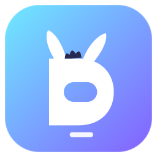

# Dockey

Een eigen taakbalk/dock voor Windows 11 (en 10): één balk met je apps, het
systeemvak en live widgets, terwijl de gewone Windows-taakbalk uit beeld gaat.

> **Status: vroege versie.** Draait op Windows 11; nog niet elk onderdeel is
> breed op verschillende pc's getest. Zie [Bekende beperkingen](#bekende-beperkingen).
> De nieuwste versie en wat er per versie veranderde, staan bij de
> [releases](https://github.com/tribalgfx/dockey/releases).
>
> Dockey heette eerst *Lichtbalk*. Bij de eerste start neemt Dockey de
> instellingen van Lichtbalk vanzelf over.

## Wat het doet

- **Apps**: vastgemaakte apps en alle open vensters, gegroepeerd per app, met de
  echte app-iconen (lukt een icoon niet via de shell, dan probeert Dockey de
  systeemlijst, het exe-bestand en tot slot het pictogram van een open venster). Bij de eerste start worden de apps overgenomen die al aan de
  Windows-taakbalk vastzitten.
- **Widgets**: nu-speelt met albumhoes en knoppen, weer (klik voor de
  komende uren en dagen), CPU-grafiek en geheugen, netwerksnelheid, volume,
  accu, agenda en klok met kalender (incl. weeknummers), plus
  [eigen widgets](#eigen-widgets) en statuswidgets voor je eigen diensten.
- **Systeemvak**: de pictogrammen van apps (OneDrive, Discord, Steam, …)
  gegroepeerd in de balk. Vastgezette pictogrammen staan in de balk, de rest
  zit achter ^; klikken en rechtsklikken gaan gewoon door naar de app.
- **Uiterlijk**: vijf stijlen (Rookglas, Glas, Zwart, Wit, Nacht), drie
  groottes, en drie vormen: een zwevende dock, een zwevend paneel over de volle
  breedte (zoals KDE Plasma) of een balk tegen de rand; onder, boven, links of
  rechts. Links of rechts geeft een look zoals de dock van Ubuntu: apps
  bovenaan, compacte widgets daaronder en de knop met het puntenraster onderaan.
  De transparantie van de balk stel je in met een schuifregelaar (Instellingen →
  Uiterlijk).
- **Taal**: Nederlands of Engels, net als de weergavetaal van Windows. Een
  andere taal kies je in Instellingen → Uiterlijk → Taal; die geldt meteen.
- **Bijwerken**: Dockey meldt zelf als er een nieuwe versie is en werkt na een
  klik bij, met een controle van de download (zie
  [Bijwerken en verwijderen](#bijwerken-en-verwijderen)).
- **Windows-taakbalk**: verbergen, automatisch verbergen of laten staan. Bij
  afsluiten komt hij terug zoals hij was; er wordt niets aan Windows gepatcht.
- **Schermruimte**: de balk meldt zich aan als "AppBar", dus gemaximaliseerde
  vensters stoppen bij de balk. Staat er een venster tegen de balk aan
  (gemaximaliseerd of onderaan over de volle breedte gesnapt), dan schuift de
  dock uit tot de volle breedte en wordt hij ondoorzichtig, zodat er geen
  bureaubladachtergrond rond de balk te zien is. Uit te zetten in de
  instellingen. Bij een schermvullende game of video gaat de balk uit de weg.

## Bediening

| Actie | Resultaat |
| --- | --- |
| Klik op een app | Starten, naar voren halen, of (als hij al actief is) minimaliseren |
| Klik op een app met meerdere vensters | Lijst met vensters |
| Middelste muisknop of Shift+klik op een app | Nieuw venster |
| Rechtsklik op een app | Menu: vensters, vastmaken/losmaken, verplaatsen, sluiten |
| Knop met het puntenraster | Startmenu van Windows |
| Rechtsklik op een lege plek of het puntenraster | Instellingen, Taakbeheer, Taakweergave, afsluiten |
| Klik op de klok | Kalender, met knop naar het meldingencentrum |
| Scrollen op volume | Harder/zachter; middelste knop dempt; klik opent de snelle instellingen |
| Klik op CPU/RAM | Taakbeheer |
| Klik op het weer | Nu, de komende uren en zeven dagen |
| Klik op ^ (systeemvak) | De overige pictogrammen; "Kiezen wat in de balk staat" zet ze vast |
| Klik op een eigen widget | Het adres dat erbij hoort (bij een statuswidget: de link uit het antwoord) |
| Widget vastpakken en slepen | Volgorde van de widgets veranderen (Instellingen → Standaardvolgorde zet hem terug) |
| Stipje op het puntenraster | Er is een nieuwe versie: rechtsklik op de balk → Bijwerken naar versie … |

Menu's gaan dicht met dezelfde knop waarmee je ze opende (Start, snelle
instellingen, de kalender, app-menu's) of met een klik op een lege plek van de
balk. De balk pakt bij een klik namelijk geen focus, net als de
Windows-taakbalk.

## Eigen widgets

Via Instellingen → Eigen widgets voeg je zelf widgets toe:

- **Statuswidget**: een adres dat het statusformaat hieronder teruggeeft, zoals
  een dashboard of een eigen script op je server. Geeft het antwoord een icoon,
  dan toont de balk alleen dat icoon met de status als rand: geen rand is alles
  in orde, geel/oranje vraagt aandacht, rood is een storing, gestippeld is
  onbereikbaar. Zonder icoon staat de tekst in de balk, in de kleur van de
  status. De details staan in de tooltip; een klik opent de link uit het
  antwoord.
- **Eigen widget**: een adres dat tekst of JSON teruggeeft, plus een
  sjabloon zoals `{temperatuur}°` of `{data.status}`. Laat het sjabloon leeg om
  de tekst zelf te tonen. Je kiest zelf hoe vaak hij ververst, een icoon
  (emoji) en eventueel wat een klik opent.

Bij beide kun je een zelfondertekend certificaat accepteren, voor diensten op
je eigen netwerk. Dockey haalt de gegevens zelf op (niet de webweergave), dus
het adres hoeft niets met CORS te doen.

### Het statusformaat

```json
{
  "status": "warning",
  "text": "1 punt vraagt aandacht",
  "short": "1",
  "detail": "• Schijf bijna vol",
  "icon": "/logo.png",
  "link": "https://mijn-server:8080/"
}
```

| Veld | Verplicht | Betekenis |
| --- | --- | --- |
| `status` | ja | `ok`, `warning` of `critical` |
| `text` | ja | Korte zin voor de balk en de tooltip (tot 80 tekens) |
| `short` | nee | Heel kort, voor een verticale dock (tot 6 tekens); standaard ✓ of ! |
| `detail` | nee | Extra regels in de tooltip |
| `icon` | nee | Vierkant plaatje (PNG, JPG of SVG); mag relatief zijn ten opzichte van het adres |
| `link` | nee | Wat een klik opent; mag ook relatief zijn. "Openen bij klik" in de instellingen gaat voor |

Dockey haalt het adres op met de interval uit de instellingen (standaard elke
minuut). Een ander antwoord dan dit formaat, of geen antwoord, toont de widget
als niet bereikbaar.

## Agenda's koppelen

Via Instellingen → Agenda's koppel je een of meer agenda's met hun iCal-link.
Dat werkt met vrijwel elke dienst; in de instellingen staat per dienst waar je
de link vindt:

- **Google**: Instellingen → je agenda → Agenda integreren → "Geheim adres in
  iCal-indeling"
- **Outlook.com**: Instellingen → Agenda → Gedeelde agenda's → Een agenda
  publiceren → ICS-link
- **Proton**: een agenda delen via een link (vraagt een betaald abonnement)
- **iCloud**: Openbare agenda → link (`webcal://` werkt ook)

De widget **Agenda** is alleen een icoon, met een stipje in de kleur van de
agenda zolang er vandaag nog iets komt. Met de muis erop zie je de afspraken van
vandaag; een klik opent de kalender met stipjes op de dagen met
afspraken, de afspraken van vandaag (of van de dag die je aanklikt) en wat er
binnenkort komt. Dockey ververst de agenda's elk kwartier. Herhalende
afspraken, uitzonderingen en tijdzones worden meegenomen.

Een iCal-link is geheim: wie hem heeft, kan je agenda lezen. Dockey bewaart hem
alleen in `%APPDATA%\Dockey\config.json` en toont in de instellingen alleen de
naam van de dienst.

## Installeren

1. Download `Dockey-Setup-<versie>.exe` bij de
   [nieuwste release](https://github.com/tribalgfx/dockey/releases/latest).
   Bij elke release staat het SHA-256-controlegetal van de installer.
2. Start het. Windows SmartScreen kan waarschuwen omdat het bestand niet
   ondertekend is ("Meer informatie → Toch uitvoeren").
   - Er is geen beheerder nodig: Dockey komt in
     `%LOCALAPPDATA%\Programs\Dockey`, met een snelkoppeling in het Startmenu.
   - De installer is Nederlands of Engels, net als de taal van Windows.
3. Laat Dockey aan het eind starten.

Windows 11 heeft alles wat nodig is al aan boord. Op Windows 10 moet de
[WebView2-runtime](https://developer.microsoft.com/microsoft-edge/webview2/)
geïnstalleerd zijn; de installer waarschuwt als die ontbreekt.

Wil je de allernieuwste stand, of liever geen installer? Bij **Actions →
Windows-build** staat van elke build op `main` de installer (`dockey-setup`) en
los `dockey.exe` (`dockey-windows-x64`), dat je overal kunt neerzetten en
starten. Die bestanden zijn alleen te downloaden met een GitHub-account en
blijven 90 dagen staan.

### Bijwerken en verwijderen

- **Bijwerken**: Dockey kijkt zelf of er een nieuwe versie is: een minuut na
  het starten en daarna eens per dag, bij de
  [releases](https://github.com/tribalgfx/dockey/releases). Is er een, dan
  krijgt de startknop een stipje, en staat bovenaan het balkmenu (rechtsklik op
  de balk) en het menu van het tray-icoon **Bijwerken naar versie …**. Daar zie
  je wat er nieuw is en kies je **Nu bijwerken**: Dockey downloadt de
  installer, controleert hem met het SHA-256-controlegetal dat GitHub bij de
  release vermeldt (klopt dat niet, dan wordt hij weggegooid), en start hem.
  De installer sluit Dockey netjes af, vervangt het programma en start Dockey
  daarna opnieuw; je instellingen blijven staan. Zonder je klik wordt er niets
  gedownload of geïnstalleerd. Het automatisch kijken zet je uit in
  Instellingen → Updates; daar kun je ook meteen controleren.

  Dit kan Dockey vanaf versie 0.3.0. Heb je 0.2.0, werk dan één keer zelf bij
  met de installer van de nieuwste release (zie hieronder); daarna gaat het
  vanzelf.

  Zelf bijwerken kan ook: draai de nieuwe `Dockey-Setup-<versie>.exe` van de
  releases. Die sluit een draaiende Dockey netjes af (de Windows-taakbalk komt
  even terug), vervangt het programma en laat je instellingen staan.
  - Een oudere Dockey (van vóór de installer) kent dat afsluiten nog niet. De
    installer vraagt dan of hij Dockey mag stoppen, stopt hem en zet daarna de
    Windows-taakbalk terug.
  - Draaide je Dockey als los `dockey.exe`: zodra de geïnstalleerde Dockey
    start, wijst "Starten met Windows" naar de nieuwe plek. Het losse bestand
    kun je daarna weggooien; je instellingen blijven gewoon staan.
- **Verwijderen**: via Instellingen → Apps → Geïnstalleerde apps → Dockey.
  Dockey sluit eerst netjes af, "Starten met Windows" wordt weggehaald, en je
  kiest of je instellingen (in `%APPDATA%\Dockey`, ook de agenda-links) ook
  weg moeten. Standaard blijven ze staan. Lukt het niet om Dockey te stoppen,
  dan breekt het verwijderen af met een melding, zodat er geen half
  verwijderde installatie achterblijft.

**Zonder vragen** (bijvoorbeeld in een script) installeer je met
`Dockey-Setup-<versie>.exe /SILENT /SUPPRESSMSGBOXES` (of `/VERYSILENT` voor
helemaal geen venster). Een draaiende Dockey wordt dan zonder vragen
gestopt; Dockey start daarna niet vanzelf. Stil verwijderen gaat met
`unins000.exe /SILENT /SUPPRESSMSGBOXES` in de installatiemap; je instellingen
blijven dan staan.

`dockey.exe --quit` sluit een draaiende Dockey netjes af; de installer
gebruikt dat ook. Draait er geen Dockey, dan doet het niets.

### Installer bouwen

Nodig: Rust en de Visual Studio C++ Build Tools (zie hieronder) en
[Inno Setup 6](https://jrsoftware.org/isinfo.php). Ontbreekt Inno Setup, dan
installeert het script het met winget.

```powershell
.\scripts\build-installer.ps1
```

Het script bouwt `dockey.exe` en laat Inno Setup (`installer\Dockey.iss`)
daar `artifacts\Dockey-Setup-<versie>.exe` van maken (ongeveer 3 MB). De
versie komt uit `src-tauri\tauri.conf.json`; `artifacts\` staat in
`.gitignore`. De Windows-build op GitHub maakt dezelfde installer bij elke
push (het artifact `dockey-setup`).

### Zelf bouwen (op Windows)

Met [Rust](https://rustup.rs) en de Visual Studio C++ Build Tools:

```bash
cd src-tauri
```

```bash
cargo build --release
```

Het resultaat staat in `target\release\dockey.exe`. Node of npm is niet
nodig: de interface is gewone HTML/CSS/JS zonder bouwstap.

## Als de Windows-taakbalk niet terugkomt

Normaal zet Dockey de taakbalk terug bij afsluiten (ook na een crash, bij de
volgende start). Mocht hij toch wegblijven of op "automatisch verbergen" blijven
staan:

```bash
dockey.exe --restore
```

Lukt ook dat niet: herstart Verkenner via Taakbeheer (Ctrl+Shift+Esc →
"Windows Verkenner" → Opnieuw starten) en zet "Taakbalk automatisch verbergen"
uit in Instellingen → Persoonlijke instellingen → Taakbalk.

Instellingen staan in `%APPDATA%\Dockey\config.json`. Dat bestand weggooien
zet alles terug naar de standaard. Is het bestand onleesbaar geraakt
(bijvoorbeeld na een crash tijdens het opslaan), dan start Dockey met de
standaardinstellingen en bewaart het een kopie als `config.onleesbaar.json`.
Problemen (zoals een icoon dat niet lukt) komen in
`%APPDATA%\Dockey\dockey.log`.

## Bekende beperkingen

- **Systeemvak**: Dockey meldt zich als tweede systeemvak aan en geeft alles
  door aan de taakbalk van Windows. Een app die niet reageert op het
  "opnieuw aanmelden" bij het starten van Dockey, verschijnt pas na een
  herstart van die app. Volume, netwerk en accu van Windows zelf zijn geen
  systeemvakpictogrammen; daarvoor heeft Dockey eigen widgets. Uitzetten kan
  bij de widgets (Systeemvak).
- **Alleen het primaire scherm** krijgt een balk.
- **Verticale dock op een laag scherm**: past niet alles, dan scrolt de lijst
  met apps; zet in dat geval wat widgets uit.
- **Glas vervaagt alleen op Windows 11.** Daar vervaagt Windows het
  bureaublad achter de balk en de panelen (acrylic), met de ronde hoeken van
  Windows zelf (8 px, dus minder rond dan de andere stijlen). Op Windows 10
  is Glas doorschijnend zonder vervaging.
- **Vensters van programma's die als administrator draaien** kan Dockey niet
  minimaliseren of sluiten (Windows blokkeert dat), tenzij Dockey zelf ook
  als administrator draait.
- **Vastgemaakte Store-apps** uit de Windows-taakbalk worden niet automatisch
  overgenomen; maak ze vast via rechtsklik zodra ze openstaan.
- Geen venstervoorbeelden bij aanwijzen, geen slepen om te ordenen (wel
  "Naar links/rechts" in het menu).

## De interface bekijken zonder Windows

De map `ui/` werkt ook los in een browser, met een nagebootste backend
(`ui/mock.js`):

```bash
python3 -m http.server 8765 --directory ui
```

Open dan `http://127.0.0.1:8765/index.html`. Met URL-parameters kies je een
variant, bijvoorbeeld `?theme=glas&size=l&layout=bar&pos=left&popup=settings`;
`?max=1` bootst een gemaximaliseerd venster na.

## Opbouw

```
ui/                  interface (HTML/CSS/JS, geen bouwstap)
  index.html, dock.js    de balk zelf
  popup.html, popup.js   het paneel: menu's, instellingen, kalender
  mock.js                nagebootste backend voor in de browser
src-tauri/           Windows-kant (Rust, Tauri 2)
  src/main.rs            vensters, commando's, achtergrondthreads
  src/shell.rs           open vensters volgen, activeren/minimaliseren/sluiten
  src/taskbar.rs         Windows-taakbalk verbergen en terugzetten
  src/appbar.rs          schermruimte reserveren
  src/backdrop.rs        echte vervaging (acrylic) achter het glasthema
  src/icons.rs           app-iconen ophalen
  src/pins.rs            vastgemaakte apps uit Windows overnemen
  src/stats.rs           CPU, geheugen, accu, netwerk, volume
  src/media.rs           nu-speelt en afspeelknoppen
  src/keys.rs            Windows-sneltoetsen (Start, Taakweergave, …)
  src/config.rs          instellingen
  src/update.rs          nieuwe versie zoeken, downloaden, controleren en installeren
```

Het logo is een D met ezelsoren (een knipoog naar *Donkie*); het gat in de D
is de dock en het streepje eronder de indicator van een actieve app. De
bronbestanden staan in `src-tauri/icons/`: `icon.svg` voor 32 px en groter,
`icon-klein.svg` (dikker, zonder details) voor 16–24 px.

Het weer komt van [Open-Meteo](https://open-meteo.com) (geen account of sleutel
nodig). Voor updates vraagt Dockey eens per dag de nieuwste release op bij
GitHub; daarbij gaat niets over jou of je pc mee (uit te zetten in Instellingen
→ Updates). Verder maakt Dockey alleen verbinding met de adressen die je zelf
invult (agenda's en eigen widgets).

## Licentie

Dockey valt onder de [GNU General Public License, versie 3 of later](LICENSE)
(GPL-3.0-or-later). Je mag het gebruiken, aanpassen en verspreiden; een
aangepaste versie die je verspreidt, valt dan ook onder de GPL, met de broncode
erbij.
